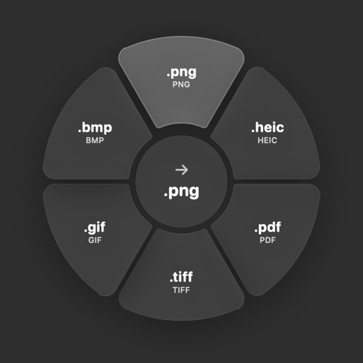

# Conversor

Convert files on your Mac straight from Finder. Right-click a file, choose **Convert to…**, and pick the new format from a ring that opens right on top of the file. The converted file is saved next to the original.

<p align="center"></p>

No window, no Dock icon, no internet. Everything uses tools built into macOS.

## Install

Open **Terminal** and paste:

```bash
curl -fsSL https://raw.githubusercontent.com/danielmsrodrigues/conversor/main/install.sh | bash
```

That's it. Then, in Finder, right-click a file → **Convert to…**

- Needs **macOS 26 (Tahoe)** or newer. Works on Apple Silicon and Intel.
- **No "app is damaged / can't be opened" warning.** macOS only quarantines files downloaded by a browser. The installer downloads with `curl`, so the app isn't quarantined and opens normally.
- Conversor starts with your Mac (you can turn this off in **System Settings → General → Login Items**). It runs in the background so the ring knows where you right-clicked. It uses almost no memory and never touches the internet.
- If **Convert to…** doesn't show up right away, relaunch Finder: hold **Option**, right-click the Finder icon in the Dock → **Relaunch**.

## What it converts

| From | To |
|---|---|
| Text, Markdown, Word, RTF, HTML, OpenDocument | PDF (A4 pages), Word (.docx/.doc), TXT, RTF, HTML, ODT |
| Images (JPEG, PNG, HEIC, GIF, TIFF, BMP, WebP…) | JPEG, PNG, HEIC, PDF, TIFF, GIF, BMP |
| PDF | PNG or JPEG (one image per page), TXT, Word, RTF |
| Audio (MP3, M4A, WAV, AIFF, FLAC…) | M4A (AAC), WAV, AIFF, FLAC |
| Video (MOV, MP4, M4V) | MP4, MOV, M4V, M4A (sound only) |

You can select several files of the same kind at once. A multi-page PDF turned into images goes into a `name (pages)` folder.

**Limitations.** macOS can't *write* MP3 or WebP, so those aren't offered as outputs (reading them works). MKV and AVI videos aren't supported. PDF → Word keeps the text, not the layout.

## Using it

- **Right-click → Convert to…** opens the ring on the file.
- Hover a slice to preview, click to convert. A ✓ confirms. Click the file name under it to show it in Finder.
- **Esc** or a click outside closes the ring.
- Opening Conversor from Applications lets you pick a file instead.
- Want a keyboard shortcut? **System Settings → Keyboard → Keyboard Shortcuts → Services → Files and Folders → Convert to…**

The interface follows your Mac's language (English or Portuguese).

## Uninstall

```bash
curl -fsSL https://raw.githubusercontent.com/danielmsrodrigues/conversor/main/install.sh | bash -s -- --uninstall
```

## Build from source

You need Xcode 26 or newer.

```bash
git clone https://github.com/danielmsrodrigues/conversor.git
cd conversor
./build.sh --install
```

`build.sh` builds a universal app in `build/`, signs it ad hoc, makes `build/Conversor.zip` for releases, and with `--install` copies it to `/Applications`.

How it's put together:

| File | What it does |
|---|---|
| `Sources/App.swift` | Background app, the Finder service, login item |
| `Sources/RingController.swift` | The floating panel: where it opens, Esc and click-outside |
| `Sources/RingView.swift` | The ring (pie slices, centre, result) |
| `Sources/RingModel.swift` | State: files, formats, converting, done |
| `Sources/Formats.swift` | File kinds and which formats each one offers |
| `Sources/Converter.swift` | The conversions (AppKit, ImageIO, PDFKit, AVFoundation, `afconvert`) |
| `Resources/*.lproj` | Translations |

---

## 🇵🇹 Em português

O Conversor converte ficheiros a partir do Finder: **botão direito num ficheiro → Converter para…** e escolhes o formato no círculo que abre por cima do ficheiro. O ficheiro novo fica ao lado do original. Não tem janela nem ícone no Dock e não usa a internet.

**Instalar:** abre o Terminal e cola:

```bash
curl -fsSL https://raw.githubusercontent.com/danielmsrodrigues/conversor/main/install.sh | bash
```

Precisas do macOS 26 ou mais recente. Como o instalador descarrega com `curl` e não pelo browser, o macOS não põe a app em quarentena e não aparece o aviso de "app danificada". A app arranca com o Mac para saber onde fizeste o clique direito; podes desligar isso em Definições do Sistema → Geral → Itens de início.

**Desinstalar:**

```bash
curl -fsSL https://raw.githubusercontent.com/danielmsrodrigues/conversor/main/install.sh | bash -s -- --uninstall
```

## License

[MIT](LICENSE)
